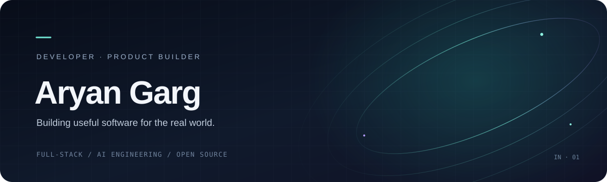
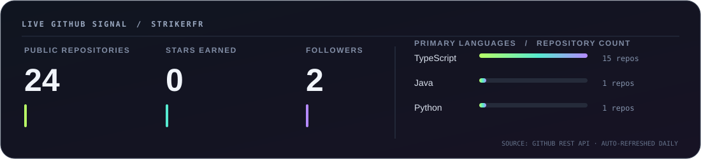
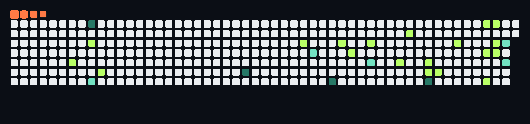

 

<a href="https://arynx.in">PORTFOLIO</a>　·　<a href="https://github.com/StrikerFr">GITHUB</a>　·　<a href="https://www.linkedin.com/in/aryan-garg-828747381">LINKEDIN</a>

  

 

## The short version

I’m Aryan Garg, a second year B.Tech CSE student who likes taking a messy real world problem and turning it into something people can use. I build full stack products, explore practical AI engineering, and learn fastest by shipping, joining hackathons, and working with other builders.

**Currently:** making useful products, experimenting with AI workflows, and getting better at the craft behind them.

## Things I’m building

<table>
<tr>
<td width="50%" valign="top">

### MediKiosk
**Voice led clinical intake · Health technology**

A multilingual patient intake and medication safety suite designed for busy clinics. The project explores how to make patient histories clearer before a clinician review.

[Source ↗](https://github.com/StrikerFr/Brijwasi-Medikiosk)　·　[Live build ↗](https://brijwasi-medikiosk.vercel.app/)

</td>
<td width="50%" valign="top">

### Sahaara
**Early warning · Elder care coordination**

A wellbeing platform for care coordinators, exploring how small changes in daily patterns can lead to timely follow up for older adults living at home.

[Source ↗](https://github.com/StrikerFr/sahaara-info)

</td>
</tr>
<tr>
<td width="50%" valign="top">

### Camply
**Campus opportunities · AI supported discovery**

A college-focused platform for discovering events and competitions, finding teammates, and recognizing participation across campus.

[Source ↗](https://github.com/StrikerFr/Camply)

</td>
<td width="50%" valign="top">

### PricePilot
**Product research · Price comparison**

A product research project for comparing prices across Indian stores, with review analysis, price history, and drop alerts.

[Source ↗](https://github.com/StrikerFr/Price-Pilot-AI)

</td>
</tr>
<tr>
<td colspan="2" valign="top">

### RocketRide
**AI development environment · Open source**

An AI workflow engine with a C++ core and nodes that extend with Python, built to help compose and inspect AI pipelines from a developer’s workspace.

[Source ↗](https://github.com/StrikerFr/rocketride-server)

</td>
</tr>
</table>

## My toolbox

These technologies appear in my public project READMEs and source manifests.

| Area | Tools I’m using and learning |
| --- | --- |
| **Languages** | TypeScript · JavaScript · Python · Java · C++ · HTML · CSS |
| **Frontend** | React · Next.js · TanStack Start · Tailwind CSS |
| **Backend & data** | Node.js · Supabase · PostgreSQL |
| **AI engineering** | LLM products · AI workflows · retrieval and product intelligence |
| **Tools & delivery** | Git · GitHub · Vercel · Docker |

## GitHub, in motion

  

<picture>
  <source media="(prefers-color-scheme: dark)" srcset="./assets/github-contribution-grid-snake-dark.svg" />
  <source media="(prefers-color-scheme: light)" srcset="./assets/github-contribution-grid-snake.svg" />
  
</picture>

 

> The metrics are generated from GitHub’s public API. GitHub Actions refreshes the contribution SVGs and GIF from the real contribution graph and stores them with this README; the `output` branch is also published as a copy.

## Hackathons

**Top 20** — Hackathon　 ·　 **Top 7** — Hypnexis Hackathon

## Say hello

[arynx.in](https://arynx.in)　·　[GitHub](https://github.com/StrikerFr)　·　[LinkedIn](https://www.linkedin.com/in/aryan-garg-828747381)

